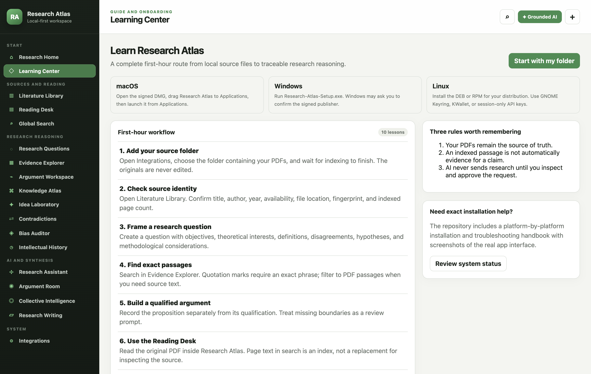

# Install Research Atlas

Research Atlas has one universal desktop client for **macOS, Windows, and Linux**. Your research database and source index remain on your computer. A separate native Swift client remains in the repository for existing macOS installations while the universal client is validated against it.

Use this page for installation and first launch. Use the [Universal User Guide](UNIVERSAL_USER_GUIDE.md) for every screen and workflow in the macOS, Windows, and Linux client. The longer [Native macOS Guide](USER_GUIDE.md) documents the separate Swift client and its additional PDFKit and Obsidian workflows.

## Before you install

You need:

- A 64-bit computer. Supported builds target Apple silicon and Intel macOS, x64 and ARM64 Windows, and x64 or ARM64 Linux.
- macOS 13 or later, Windows 10 or later, or a current 64-bit Linux distribution such as Ubuntu 22.04+, Debian 12+, Fedora 40+, or a compatible derivative.
- Enough free space for the app, its local SQLite index, and any local AI model you choose. PDFs are not copied into the app.
- A normal local folder containing your research PDFs. A network or cloud-synchronised folder can be indexed, but it must be available whenever you use the app.

AI is optional. Ollama or LM Studio can run locally; OpenAI, Anthropic Claude, Google Gemini, and compatible HTTPS services require their own API key and may charge for use.

Every release includes `SHA256SUMS.txt`. Before opening an installer, compare its published hash with the file you downloaded:

- macOS: `shasum -a 256 <downloaded-file>`
- Windows PowerShell: `Get-FileHash <downloaded-file> -Algorithm SHA256`
- Linux: `sha256sum <downloaded-file>`

If the value differs, do not install the file.

## macOS

1. Download the `Research Atlas.dmg` file for your Mac from the release assets.
2. Double-click the DMG.
3. Drag **Research Atlas** into **Applications**.
4. Eject the Research Atlas disk image.
5. Open **Applications → Research Atlas**.
6. On first launch, macOS may ask you to confirm the signed developer. Confirm only when the publisher and checksum match the release notes.

Existing users of the Swift macOS client do not need to import their database. The universal client uses the same application-support location and schema. Close one client before opening the other.

Local data location:

`~/Library/Application Support/Research Atlas/`

## Windows 10 or 11

1. Download `Research-Atlas-Setup.exe` from the release assets.
2. Double-click the installer. It installs for the current Windows user and does not require administrator access.
3. If Windows shows a publisher prompt, confirm that the publisher and checksum match the release notes before continuing.
4. Open **Research Atlas** from the Start menu.

Local data location:

`%APPDATA%\Research Atlas\`

Do not run the portable ZIP directly from a network share. Extract it to a local folder first so Chromium's sandbox can operate correctly.

## Ubuntu, Debian, Linux Mint, or Pop!_OS

1. Download the `.deb` file from the release assets.
2. Open it with your graphical Software application and choose **Install**.
3. If your desktop does not provide a graphical installer, open a terminal in the download folder and run:

   ```sh
   sudo apt install ./research-atlas-desktop_*.deb
   ```

4. Open **Research Atlas** from the application menu.

Local data location:

`~/.config/Research Atlas/`

For secure persistent API-key storage, install and unlock the secret service used by your desktop (for example GNOME Keyring or KWallet). When no supported service is active, Research Atlas deliberately permits **session-only** keys and disables persistent key storage.

## Fedora, RHEL, Rocky Linux, or openSUSE

1. Download the `.rpm` file from the release assets.
2. Open it with the graphical software installer, or run this in the download folder:

   ```sh
   sudo dnf install ./research-atlas-desktop-*.rpm
   ```

3. Open **Research Atlas** from the application menu.

On openSUSE, use `sudo zypper install ./research-atlas-desktop-*.rpm`.

## First launch: the exact five-minute setup



1. Open **Learning Center** in the left sidebar.
2. Open **Integrations**.
3. Under **Local research sources**, choose **Choose or refresh folder**.
4. Select the folder that already contains your PDFs. Research Atlas scans nested folders but skips hidden folders, application packages, symbolic links, and non-PDF files.
5. Keep the app open until the indexing banner disappears. A damaged or unreadable PDF is reported without stopping the rest of the folder.
6. Open **Literature Library**. Select a paper and confirm its file path, SHA-256 fingerprint, page count, and availability.
7. Open **Research Questions** and create your first question. Research Atlas creates a starter project automatically on a new installation.
8. Search an exact phrase in **Evidence Explorer**, open the original in **Reading Desk**, and record the interpretation separately from the quotation.
9. Open **Integrations → Back up database** and save the first recovery copy somewhere separate from the live database.


## Optional local AI

### Ollama

1. Install Ollama from its official distribution and start it.
2. Make sure your chosen model exists, for example `qwen3:latest`.
3. In Research Atlas, open **Integrations → AI provider**.
4. Choose **Ollama (local)**.
5. Use endpoint `http://127.0.0.1:11434` and enter the exact model identifier shown by Ollama.
6. Save settings, then choose **Test connection**. No API key is required.

### LM Studio

1. Load a model in LM Studio and start its local server.
2. In Research Atlas choose **LM Studio (local)**.
3. Confirm endpoint `http://127.0.0.1:1234/v1` and enter the model identifier exposed by the server.
4. Save and test the connection.

Research Atlas does not extract model weights from LM Studio. Both products may use the same compatible model file only when you configure their model stores explicitly; copying opaque managed files is unreliable and can breach a model licence.

## Optional hosted AI


1. In **Integrations → AI provider**, select OpenAI, Anthropic Claude, Google Gemini, or OpenAI-compatible.
2. Enter the provider's official HTTPS endpoint and exact model identifier.
3. Turn on **Hosted AI transmission**. This does not send anything by itself.
4. Paste the API key and choose either:
   - **Use key this session** — the key disappears when Research Atlas closes and never invokes the operating-system credential store.
   - **Store securely** — macOS Keychain, Windows DPAPI, or a supported Linux secret service encrypts the key outside the research database.
5. Choose **Test connection**. The test sends only a fixed health-check sentence, not papers, notes, questions, or database content.
6. On a research page choose **✦ Grounded AI**, select sources, and choose **Preview transmission**. Read the destination, task, and every passage before choosing **Approve and send once**.

The test button works with a key currently in the field, a session key, or an encrypted stored key. You do not need to store a replacement key merely to test it.

## Move or back up Research Atlas

- **Complete recovery copy:** Integrations → **Back up database**. This preserves every Research Atlas record.
- **Readable interchange copy:** Integrations → **Export portable JSON**. This excludes credentials and original PDFs.
- **Original sources:** Copy or synchronise your PDF folder using your normal file-management tool. Research Atlas never hides or takes ownership of it.

Never synchronise the live `research-atlas.sqlite3`, `-wal`, and `-shm` files while the app is open. Back up from inside Research Atlas instead.

## Troubleshooting

### A PDF is marked missing

Put the drive or network folder back online, then run **Choose or refresh folder** again. If the file was moved outside that folder, add it directly from **Literature Library → Add PDFs**.

### A scanned PDF has no searchable text

Research Atlas detects very low extracted text but does not silently invent OCR. Run OCR in a trusted PDF tool, save a new searchable PDF, and refresh the folder.

### Ollama or LM Studio will not connect

- Confirm the local server is running.
- Use `127.0.0.1`, not another computer's address.
- Confirm the model identifier exactly, including any tag after `:`.
- Test the provider before sending research context.

### Secure key storage is unavailable on Linux

Unlock GNOME Keyring or KWallet and restart Research Atlas. You can always choose **Use key this session** without persisting it.

### macOS keeps asking for Keychain access

Use the signed release build from Applications. Moving, renaming, rebuilding, or repeatedly ad-hoc-signing the app can make macOS treat it as a different application. Until the signed build is installed, use a session-only key to avoid recurring prompts.

### Windows or macOS blocks an unsigned development build

Do not disable operating-system security globally. Use a signed release or build from the reviewed source. The public release checklist requires platform signing, macOS notarization, checksums, and a clean-account installation test.

## Build from source

Developers need Git and Node.js 24.15 or newer:

```sh
git clone <repository-url>
cd research-atlas/Desktop
npm ci
npm test
npm start
```

Build the installer for the operating system currently in use:

```sh
npm run make
```

Installers are platform-specific. Build the DMG on macOS, the Squirrel installer on Windows, and DEB/RPM packages on Linux. The repository's GitHub Actions matrix repeats those builds on all three operating systems.
