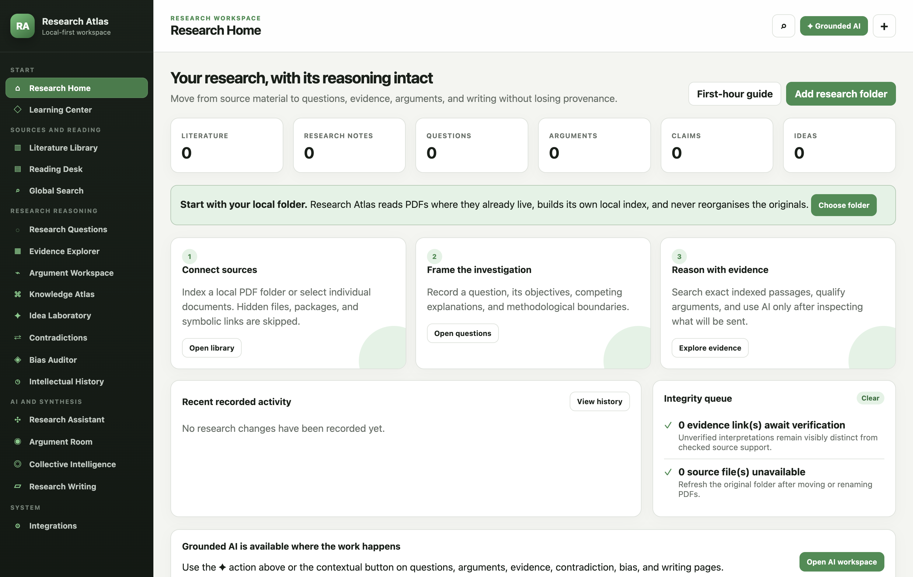

# Research Atlas

[](LICENSE)
[](https://github.com/Azeezhamzat/research-atlas/actions/workflows/ci.yml)

Research Atlas v1.10.0 is a local-first research workspace for **macOS, Windows, and Linux**. The universal desktop client is built with Electron, a sandboxed renderer, SQLite FTS5, and PDF.js; the established native SwiftUI/PDFKit macOS client remains in the repository during parity validation. Both use schema version 16 and preserve the same local-first, provenance-aware research model.

Research Atlas recursively indexes a read-only local PDF folder, then connects that source material to projects, research questions, structured claims, ideas, search, versioned arguments, source-linked evidence, grounded retrieval, contradiction review, a knowledge atlas, recorded history, optional source-grounded AI, critical auditing, deliberation, evidence-linked writing, and controlled collective-role simulations. A task-oriented Learning Center documents the first-hour workflow and every safety boundary inside the app.



The documentation images preserve the real Research Atlas interface and contain no person or surrounding desktop. They were captured from isolated empty or synthetic workspaces; no private path, credential, notification, or live research title is present.

AI is disabled by default and is not required for core work. When configured, contextual AI cards appear on Research Home, research questions, arguments, saved retrieval sets, and writing sections; they carry the current task into Research Assistant, Bias Auditor, or Argument Room instead of requiring a separate blank-chat workflow. The app prefers a retrieval set containing the papers linked to that context and reports the exact overlap; a zero-overlap set receives an explicit warning rather than a false relevance claim. Contradiction Detective and Collective Intelligence Lab provide their own guarded model actions. All of them operate from a selected saved retrieval set only. The Assistant can ground answers in exact paper passages (`[S#]`) and separately labelled researcher-note excerpts (`[N#]`); notes are never represented as published evidence. Every hosted or local model request has a separate transmission preview where the exact source text can be expanded and inspected before approval. Returned citations must match the supplied labels, and saved model output remains visibly reviewable until a researcher records a decision.

Performance is verified with a reproducible optimized-release profile that exercises 3,000 papers and 36,000 page passages without opening personal files. On the development Mac, global search remained below 48 ms at p95, grounded retrieval below 157 ms at p95, and a complete FTS rebuild completed in 1.08 seconds. See `TESTING.md` and `Benchmarks/README.md` for the exact method and machine-readable report.

## Install on macOS, Windows, or Linux

Follow [INSTALL.md](INSTALL.md) for precise graphical and command-line instructions, first-run setup, local AI configuration, data locations, migration, backup, and troubleshooting. Every universal-client screen and workflow is documented in [UNIVERSAL_USER_GUIDE.md](UNIVERSAL_USER_GUIDE.md); [USER_GUIDE.md](USER_GUIDE.md) is explicitly the separate native macOS handbook.

The universal client requires a 64-bit system: macOS 13+, Windows 10+, or a current 64-bit Linux distribution. Core features work without AI and without a network connection. Original PDFs remain in the folder you choose.

## Run the universal desktop client from source

With Node.js 24.15 or newer:

```sh
cd Desktop
npm ci
npm test
npm start
```

Create the native installer for the current operating system with `npm run make`. Cross-platform release builds run independently on macOS, Windows, and Linux because installers are platform-specific.

## Run the existing native macOS client from source

The Swift client requires macOS 14 or later and Xcode 16 or later.

### Open and run in Xcode

1. Open `Package.swift` in Xcode.
2. Select the `ResearchAtlas` scheme and **My Mac**.
3. Press Run.

The app stores its own database at:

`~/Library/Application Support/Research Atlas/research-atlas.sqlite3`

Original PDFs and Obsidian files are never modified.

### Build a standalone macOS app from Terminal

```sh
chmod +x Scripts/build-app.sh
Scripts/build-app.sh
open "Build/Research Atlas.app"
```

## First use

1. Open **Learning Center** or press **⌘?** for the complete guided first-hour workflow and searchable feature reference.
2. Choose the active project above the grouped sidebar. Research Home scopes its questions, arguments, ideas, writing, resume actions, and integrity queue to that context; **⌘K** or **⌘F** opens Global Search from anywhere.
3. Open **Integrations** and choose the local research folder. Optionally choose an Obsidian vault.
4. Alternatively, use **Literature Library → Add PDF** for one document outside the saved folder.
5. Search imported metadata, Markdown, and machine-readable PDF pages in **Global Search**. Results update while you type; quotation marks require an exact phrase, the result-type menu narrows a mixed result set, and selecting a result opens the exact question, comparison, concept, writing record, or indexed PDF page.
6. Filter the Literature Library by author, year, tag/topic, PDF state, and Obsidian-link state.
7. Review explicit Obsidian-paper match suggestions in a paper's detail view, or link a note manually. Optional title suggestions are off by default, labelled lower confidence, and never silently confirmed.
8. Create a project and research questions.
9. Create an argument, select an exact passage in the Reading Desk, and link it as evidence with its page, normalized selection geometry where PDFKit supplies reliable bounds, document fingerprint, and verification state preserved.
10. Open a geometry-backed evidence annotation at its source location, or edit/delete the application-owned annotation without modifying the PDF.
11. Revise arguments with an explicit change note; Research Atlas retains each observed state.
12. Save an inspectable full-text query in **Evidence Explorer**. Each result retains exact paper passages and matching researcher-note excerpts as distinct snapshot types; pages, extraction metadata, document fingerprints or note modification state, and later staleness remain inspectable.
13. Build a manual literature-comparison matrix. Blank methodological fields display as unavailable rather than being filled speculatively.
14. Return to a research question and inspect its local coverage audit: publication years, paper tags, recorded designs/frameworks, profile completeness, and unavailable source records. Every result is explicitly bounded to the linked set and is not presented as a gap in the wider literature.
15. Define concepts and add typed, evidence-bearing links in **Knowledge Atlas**. Its visual graph opens on connected evidence, offers labelled type clusters for all records, progressively reveals labels in dense views, and supports zoom, filtering, neighbourhood focus, provenance inspection, and direct source navigation. Relationships record their origin and verification state.
16. Review, cancel, or diagnose local indexing work in **Integrations → Indexing activity**.
17. Select an exact PDF passage and save a structured claim whose category, author terminology, methods, context, extraction origin, review state, and revisions remain distinct from the quotation.
18. Develop research questions with objectives, concepts, hypotheses, disagreements, methods, literature, arguments, and observed revision history.
19. Capture ideas in **Idea Laboratory**, link their sources, progress their status, and use local missing-evidence challenge prompts.
20. Compare apparently conflicting findings in **Contradiction Detective** without assuming different contexts constitute a contradiction. Optionally prepare a consent-gated model assessment; it remains a reviewable suggestion and never silently changes the case status.
21. Review only recorded application changes in **Intellectual History**; the app does not reconstruct unobserved past states.
22. Optionally configure OpenAI Responses, Anthropic Claude, Google Gemini, **Local Research AI**, LM Studio Local, or a custom OpenAI-compatible HTTPS provider in **Integrations**. Local Research AI uses `gpt-oss:20b` by default and starts Research Atlas's bundled Ollama engine on demand; the Ollama or LM Studio app does not have to remain open. Model weights stay in the existing local Ollama store. Hosted credentials have separate Keychain entries and are never written to the database or exports.
23. Open the **Grounded AI** card on Research Home, a question, an argument, a saved retrieval set, or a writing section to carry the current task into **Research Assistant**. Alternatively, open it from the sidebar. Confirm the selected retrieval set, then inspect the destination, separately labelled paper/note source list, task, and request size before approving a single transmission. Unsupported, uncited, or unknown-source responses are rejected; accepted claim candidates are still saved as unverified.
24. Run **Research Bias Auditor** against a recorded argument. Choose a local rule-based review or a consent-gated, source-grounded model review. Neither diagnoses psychological bias; every concern can be accepted, dismissed, annotated, or marked addressed.
25. Use **Argument Room** to create a local critical-review scaffold or a grounded, multi-phase model deliberation. Every generated role is disclosed as a simulation produced by the same configured model, exact citations are preserved per message, consensus is not assumed, and researcher responses remain distinct.
26. Create an outline in **Research Writing**, link claims/evidence/papers while preserving DOI or citation keys, run cautious statement-level checks for causal overstatement, overbreadth, missing qualifications, low textual match, and unverified support, inspect the closest linked record, and export the workspace to Markdown.
27. Use **Collective Intelligence Lab** to design a controlled role simulation, then run one consent-gated, paper-grounded model turn at a time. Each turn validates citations, confidence, uncertainty, and evidence sufficiency; records the exact prompt, provider/model/settings, role condition, response, interruptions, and source snapshots; and keeps human observations distinct. All roles use the same configured model and are not independent experts or validated human collective intelligence.
28. Use **Integrations → Export and recovery** for a consistent SQLite backup, a portable Markdown/JSON/CSV package, or a validated database restore.

Folder refreshes are repeatable and content-aware. Research Atlas scans nested folders, skips hidden files, packages, symbolic links, and non-PDFs, fingerprints each candidate, avoids duplicate records for identical bytes, and re-indexes only new or changed files. A single unreadable file is recorded without stopping the rest of the scan.

Database restore is deliberately staged: Research Atlas opens the selected backup read-only, checks integrity, foreign keys, required tables, and schema compatibility, then shows record counts. On confirmation it creates an automatic pre-restore recovery copy, restores and migrates the selected database, and rebuilds derived search data. A failed restore attempts to roll back to the recovery copy.

Research Atlas records a SHA-256 fingerprint and byte count when it imports, verifies, or repairs a PDF. The library distinguishes missing files from files changed since verification. **Locate PDF** previews the candidate's identity, size, and page count before updating the application-owned path and derived page index; choosing a different file never changes the paper, argument, or evidence UUIDs.

Scanned PDFs are identified when little or no text can be extracted; Research Atlas does not perform OCR.

The standalone illustrated handbook is available at [USER_GUIDE.md](USER_GUIDE.md). The same material is presented as 23 task-oriented lessons inside Learning Center, with progress tracking stored locally.

## Verification

Run the public-repository guard and self-contained checks:

```sh
Scripts/verify-public-repository.sh
swift run ResearchAtlasChecks
```

On the current build host, use the compatible SDK environment documented in `TESTING.md`.

## Repository privacy

Research Atlas stores private research in local databases, backups, portable exports, saved source folders, and optional provider credentials. The repository ignore rules exclude those artefacts, ChatGPT project-source mirrors, model weights, machine-specific benchmark captures, and build output. Only privacy-safe demonstration screenshots belong in `Support/Tutorial` with the `-public` suffix.

Before every push, run `Scripts/verify-public-repository.sh`. It rejects private-data directories, absolute macOS home paths, common credential formats, oversized tracked files, and missing release assets. The GitHub Actions workflow runs the same guard alongside the build and deterministic checks.

## Licence and collective contribution

Research Atlas is open source under the [Apache License 2.0](LICENSE). You may use, study, modify, and redistribute it under that licence; its explicit patent grant gives contributors and adopters additional clarity. Contributions are welcome under the same terms—start with [CONTRIBUTING.md](CONTRIBUTING.md).

Third-party components and optional runtimes keep their own licences. See [THIRD_PARTY_NOTICES.md](THIRD_PARTY_NOTICES.md) and [Desktop/THIRD_PARTY_LICENSE_INVENTORY.md](Desktop/THIRD_PARTY_LICENSE_INVENTORY.md).

## Distribution status

`Scripts/build-app.sh` creates an ad-hoc signed local build. It is suitable for development on the machine that built it, but it is not a notarized public release. Before distributing binaries to other users, use a Developer ID signing identity, enable hardened runtime as appropriate, archive the exact third-party-runtime notices for the bundled version, notarize and staple the app, and test it on a clean macOS account. The complete gate is in `RELEASE_CHECKLIST.md`.
