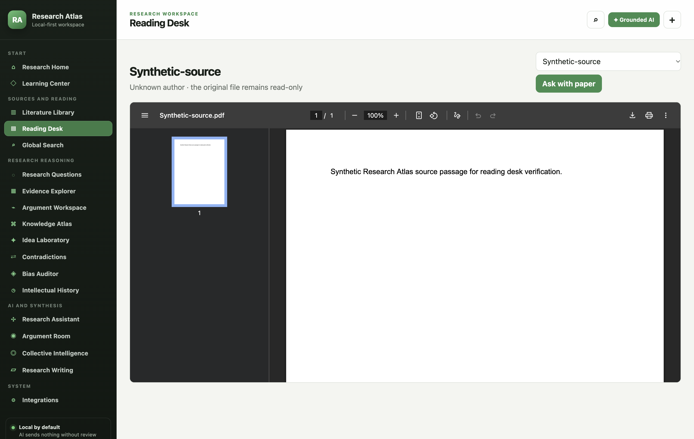
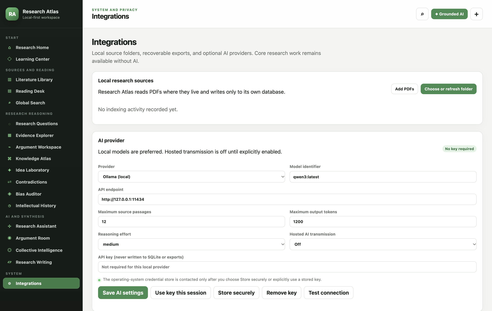

# Research Atlas 1.10 — Universal User Guide

This is the handbook for the universal Research Atlas client on macOS, Windows, and Linux. It documents what the current interface actually does. Installation, system requirements, and operating-system troubleshooting are in [INSTALL.md](INSTALL.md).

Research Atlas is local-first. It reads PDFs from folders you select, stores its index and research records in a local SQLite database, and works without an AI provider. Original PDFs remain the source of truth and are never reorganised or edited.

## 1. Start safely

1. Open **Integrations** and choose **Choose or refresh folder**.
2. Select the folder containing your PDFs. Subfolders are included; hidden folders, application packages, symbolic links, and non-PDF files are skipped.
3. Keep Research Atlas open until the indexing banner disappears.
4. Open **Literature Library** and inspect a paper's path, SHA-256 fingerprint, page count, and availability.
5. Open **Evidence Explorer**, search for a known phrase, and inspect the indexed page result against the PDF in **Reading Desk**.
6. Create a research question and a qualified argument.
7. Make a database backup from **Integrations** before doing extensive work.

Use **Learning Center** for the same first-hour path inside the app. Press `F1` on Windows or Linux, or choose **Help → Learning Center** on any platform.

## 2. Navigation and shortcuts

The left sidebar groups source work, research reasoning, AI/synthesis, and system settings. The top-right buttons open Global Search, Grounded AI, and the add-PDF picker.

- `Ctrl+K` on Windows/Linux or `Command+K` on macOS opens Global Search.
- `Ctrl+O` or `Command+O` adds selected PDFs.
- `Ctrl+Shift+O` or `Command+Shift+O` selects and refreshes a folder.
- `Escape` closes an open dialog.

## 3. Research Home

Home reports locally recorded counts for literature, questions, arguments, claims, ideas, and notes. **Recent recorded activity** contains only changes Research Atlas observed. **Integrity queue** reports unverified evidence links and unavailable source files; an empty queue does not mean the literature or argument is complete.

The starter project named **My Research Project** is created automatically in a new database. The universal client currently uses that project for new questions. Advanced multi-project management remains available in the native macOS client while it is brought to parity here.

## 4. Literature Library

Use **Add PDFs** for individual files or **Add folder** for a recursive scan. Research Atlas extracts page text with PDF.js and stores a searchable copy in its database. A SHA-256 fingerprint prevents the same document bytes from being imported twice.

Filter by title/author/abstract/tag, publication year, or availability. Select a paper to inspect:

- source availability and indexed-page count;
- original local path;
- SHA-256 document fingerprint;
- last verification time;
- linked evidence and claim counts.

File names provide the initial title when embedded bibliographic metadata is unavailable. Research Atlas does not invent missing authors, dates, abstracts, or citation data.

## 5. Reading Desk

Select **Read PDF** from a library record. The embedded system reader provides page navigation, thumbnails, zoom, in-document search, print, and save/download controls while the original file remains read-only.

The page text stored in search is an index, not a substitute for reading the original page. The universal client does not yet save dragged PDF selections or selection geometry; record exact quotations and typed evidence in the native macOS client when that workflow is required. This boundary is deliberate and is not hidden behind simulated controls.

## 6. Global Search and Evidence Explorer

Both screens search the local SQLite FTS5 index. Global Search covers papers, PDF passages, questions, arguments, concepts, claims, ideas, and writing. Evidence Explorer emphasises source passages.

- Enter ordinary terms for token-prefix matching.
- Put a phrase in quotation marks when word order and adjacency matter.
- Use the record-type selector to narrow results.

Search hits are retrieval candidates. A matching passage does not automatically support a claim; inspect the original PDF and record the relationship separately.

## 7. Research Questions

Choose **New question** and record the question, status, objectives, working notes, theoretical interests, conceptual definitions, unresolved disagreements, possible hypotheses, and methodological considerations. Use **Edit** to revise the record and **Delete** only after reading the confirmation. Every create, update, and delete action produces an Intellectual History event.

**Examine** opens Grounded AI with the question as context. You must still choose the source papers and approve the exact request.

## 8. Argument Workspace

Keep a proposition separate from its qualification and boundary conditions. Status values distinguish developing, qualified, contested, supported, and retired arguments. **Examine** prepares a critical AI task without treating the model response as verified evidence.

The universal client preserves argument records and can report evidence already present in a schema-compatible database. Creating a page-specific evidence relationship from a dragged PDF selection remains a native macOS workflow in this release.

## 9. Knowledge Atlas

Knowledge Atlas stores bounded concept records: name, working definition, boundary notes, verification state, and origin. It intentionally does not draw every indexed title as a force-directed graph. The universal view is a readable concept register until relationship editing and a filtered, evidence-aware graph reach feature parity.

Use **Researcher**, **Source**, or **AI suggestion** origin labels honestly. An AI suggestion should remain unverified until you inspect its source support.

## 10. Idea Laboratory

Record an idea's title, body, state, assumptions, alternative explanations, evidence needed, and investigation notes. Move it from seed to developing/testing/integrated only when your own review justifies the change. AI examination creates a reviewable analysis; it does not change the idea automatically.

## 11. Contradictions

Create a case for an apparent conflict and record its summary, status, and next investigation or resolution. Use **Contextual difference** when population, design, measure, or scope explains the apparent disagreement. Research Atlas does not infer that two findings contradict merely because their conclusions differ.

## 12. Bias Auditor

The offline local audit flags missing qualifications and absolute or causal wording such as “always,” “never,” “proves,” or “causes.” These are prompts for review, not diagnoses of researcher bias. **Grounded model review** is optional and follows the same source-selection and preview boundary as every other AI request.

## 13. Intellectual History

History lists create, update, delete, import, and reindex events actually recorded in the database. It does not reconstruct edits made outside the app or thoughts that were never saved.

## 14. Research Assistant

Choose **New grounded analysis**, enter a bounded task, and select the PDFs whose indexed passages may be supplied. Choose **Preview transmission** before **Approve and send once**. The preview is authoritative: it shows the provider, model, destination, task, exact passages, page numbers, and character count.

Returned text is stored in Analysis History with provider/model metadata and remains **review required**. Check every `[S#]` citation against the supplied passage. A model should state that evidence is insufficient when the selected sources do not answer the question.

## 15. Argument Room and Collective Intelligence

Argument Room prepares a source-grounded critique of a recorded proposition. Collective Intelligence prepares sequential role prompts over an inspectable evidence set. Role labels do not create independent experts or human collective intelligence; all roles use the configured provider unless you deliberately run separate providers and record that fact.

Keep each role's information conditions and output separate. Do not treat agreement between model roles as truth.

## 16. Research Writing

Create a writing document with title, purpose/audience, status, and planning notes. Grounded AI can critique a selected source set but cannot silently write into or change the record. Full section editing, exact evidence links, and citation-review workflows remain in the native macOS client during parity work.

## 17. AI providers

### Local providers

- **Ollama:** use `http://127.0.0.1:11434` and the exact model name shown by `ollama list`, such as `qwen3:latest`.
- **LM Studio:** start its local server, use `http://127.0.0.1:1234/v1`, and enter the served model identifier.

Local providers need no API key. Only loopback cleartext HTTP is accepted; a remote unencrypted model endpoint is rejected.

### Hosted providers

OpenAI, Anthropic Claude, Google Gemini, and custom OpenAI-compatible services require an HTTPS endpoint and usually an API key. Turn on **Hosted AI transmission** before use. This switch permits requests but sends nothing by itself; each research request still needs a separate preview and approval.

You may test with a key currently in the field, keep it for the current app session, or explicitly store it with the operating system. Settings screens and app launch do not read the secure credential store. On Linux, Research Atlas refuses Electron's insecure `basic_text` fallback and offers session-only storage instead.

## 18. Backup, export, and moving computers

- **Back up database** creates a complete SQLite recovery copy.
- **Export portable JSON** creates readable interchange data without API credentials or original PDFs.
- **Show local database** reveals the active application-data location.

Do not synchronise the live SQLite database, WAL, or SHM files while Research Atlas is open. To move computers, install the target-platform build, copy the PDF folder using your normal file tool, restore a validated database backup or retain the portable export, then refresh the copied PDF folder so local paths are current.

## 19. Current parity boundary

The universal client covers local folder/PDF indexing, reading, full-text search, core research records, history, cautious local checks, backup/export, and grounded AI across macOS, Windows, and Linux. The separate native macOS client still has the deeper Obsidian connection, precise PDF-selection geometry, richer evidence-link editing, literature comparison, visual relationship tooling, version review, and full writing-section workflows described in [USER_GUIDE.md](USER_GUIDE.md).

This distinction is intentional. Research Atlas should never present a placeholder or simplified control as if it already had the stronger provenance behaviour of the native workflow.
