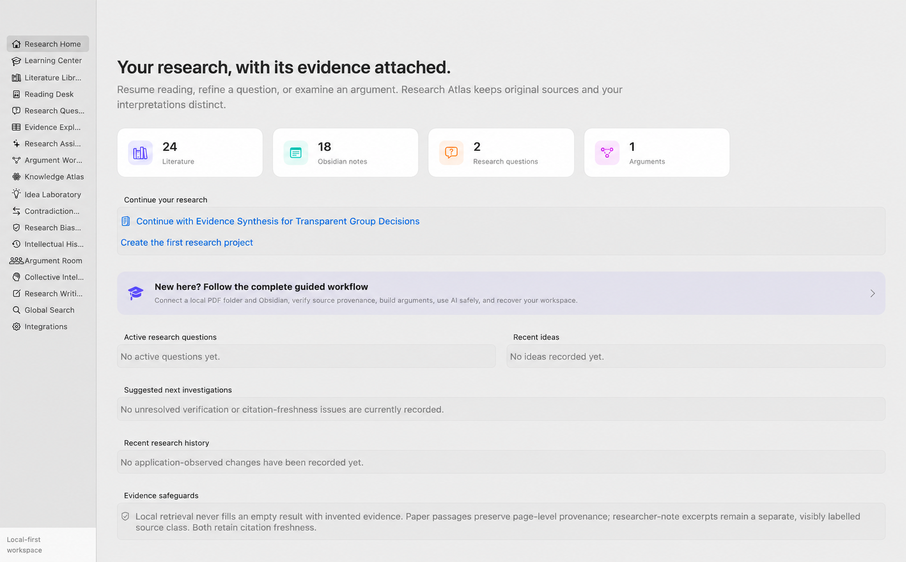
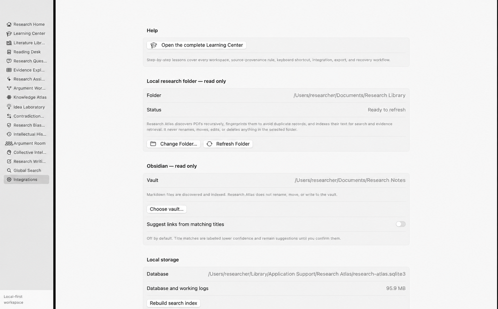
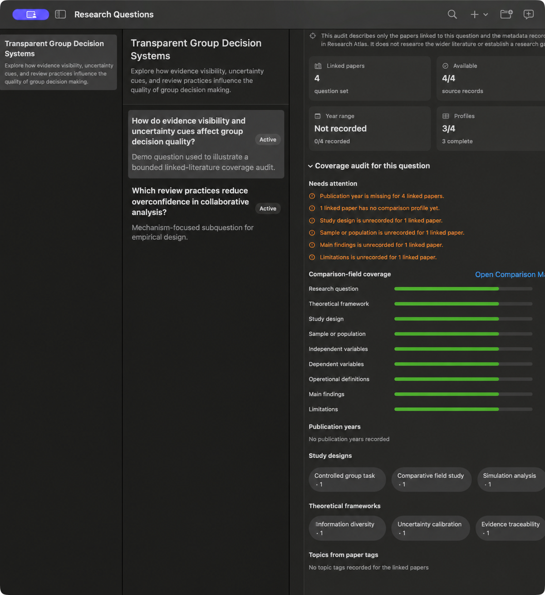

# Research Atlas 1.10 — Native macOS Illustrated Guide

> This handbook describes the separate SwiftUI/PDFKit macOS client, including Obsidian linking and precise PDF selection geometry. For the universal macOS, Windows, and Linux client, use the [Universal User Guide](UNIVERSAL_USER_GUIDE.md). Installation for both clients is explained in [INSTALL.md](INSTALL.md).

Research Atlas is a local-first macOS workspace for moving from source material to traceable research reasoning. It keeps four kinds of information visibly separate:

1. **Source records** — local PDF text, exact quotations, pages, paths, and file fingerprints.
2. **Researcher work** — questions, arguments, notes, ideas, qualifications, comparisons, and review decisions.
3. **Generated candidates** — optional AI answers, claims, concerns, contradiction assessments, and simulated deliberation.
4. **Verification state** — whether a record is current, stale, verified, rejected, accepted, dismissed, or superseded.

The central rule is simple: Research Atlas should help you reason with evidence without making the evidence look more certain, complete, or authoritative than it is.

The illustrations preserve the real Research Atlas interface. Identifying paths and live research titles have been replaced with synthetic demonstration text so the handbook can be shared safely.

## 1. The ten-minute start

1. Launch Research Atlas and open **Integrations**.
2. Under **Local research folder**, click **Choose Folder…** and select the folder where your PDFs already live.
3. Wait for the first recursive scan. Research Atlas indexes readable PDFs without copying, moving, renaming, or editing them.
4. If you use Obsidian, click **Choose vault**, select the vault folder, and scan it. The vault is also read-only.
5. Open **Literature Library**, select a paper, and inspect its path, PDF state, fingerprint, and verification time.
6. Use **Refresh Folder** whenever PDFs are added, moved, or changed. Unchanged content and duplicate bytes are skipped.
7. Open an available PDF in **Reading Desk**. Select the smallest exact passage that supports the point you need.
8. Create a project, research question, and argument. Link the passage as supporting, challenging, qualifying, contradicting, contextual, or other typed evidence.
9. Open **Evidence Explorer**, save a query, and inspect the captured passages and note excerpts.
10. Return to **Integrations** and make both a database backup and a portable export.

You can reopen this material inside the app at any time with **⌘?** or by selecting **Learning Center**.

## 2. Local research folder: safe, repeatable indexing

Research Atlas treats your folder as the source of truth and its own SQLite database as a derived research workspace. The source tree is read-only.

### Connect the folder

1. Open **Integrations → Local research folder — read only**.
2. Click **Choose Folder…** and use the native macOS picker.
3. Research Atlas saves a security-scoped bookmark, recursively discovers `.pdf` files, and starts a recorded indexing job.
4. Watch the status summary and progress in **Indexing activity**.
5. Open **Literature Library** to inspect imported papers.

Discovery skips hidden files, symbolic links, application packages, and non-PDF files. Nested folders are supported. No source file is copied into the app.

### Identity and duplicate handling

Each readable PDF receives:

- its standardized local path;
- byte count;
- a SHA-256 content fingerprint;
- verification time;
- a page-by-page text index where machine-readable text exists.

On refresh, an unchanged path and fingerprint is skipped. If identical bytes also exist at another readable path, Research Atlas keeps one paper record rather than creating a duplicate. If a known PDF moved and the old path is unavailable, the matching fingerprint lets the app reuse the existing paper identity and rebuild its link safely.

### Refresh and cancellation

- **Refresh Folder** scans the saved folder again.
- New and changed PDFs are indexed; unchanged and duplicate files are skipped.
- A failure reading one file is recorded and does not prevent later files from being checked.
- Cancelling stops future work but retains PDFs already committed in earlier completed steps.
- An interrupted job is reported as failed on the next launch rather than pretending it completed.

### Single-PDF import and repair

**Add PDF** imports one file using the same fingerprint-based duplicate protection. **Locate PDF** and **Review Changed PDF** preview the candidate path, byte count, page count, and SHA-256 before changing the application-owned link. The PDF itself is never modified.

### Folder troubleshooting

| Symptom | What to check |
|---|---|
| Folder unavailable | The folder may have moved or macOS permission changed; choose it again. |
| No PDFs found | Confirm files use the `.pdf` extension and are not hidden or symbolic links. |
| PDF appears unchanged | Compare the displayed fingerprint and verification time, then refresh. |
| Little or no searchable text | The PDF may be scanned; Research Atlas does not currently perform OCR. |
| Duplicate skipped | The same document bytes are already indexed at another readable path. |
| One file failed | Other files continue; inspect the indexing job message and open the PDF manually. |

## 3. Obsidian: read-only researcher context

1. Open **Integrations → Obsidian** and choose the vault folder.
2. Research Atlas stores a macOS security-scoped bookmark and recursively discovers Markdown files.
3. It indexes headings, simple YAML frontmatter, tags, wikilinks, citation keys, DOI strings, and note text.
4. Paper-note suggestions use exact DOI or citation-key matches. Optional normalized-title matching is off by default and remains lower confidence.
5. Confirm, reject, add, or remove relationships from a paper's detail pane. Those decisions survive rescans.
6. **Open in Obsidian** opens the original note. Research Atlas never edits, renames, moves, or deletes it.

When unfiltered Evidence Explorer queries match note text, the captured excerpts use `N` labels and are explicitly identified as researcher context. They are never represented as published evidence.

## 4. Literature Library

Use the library to inspect sources before interpreting them.

- Expand **More filters** for author, year, topic/tag, PDF status, or Obsidian-link status. Search titles, authors, abstracts, or DOIs within that visible set.
- Distinguish PDF states: available, unlinked, missing, or changed since verification.
- Inspect DOI, citation key, tags, collections, source availability, local path, SHA-256 fingerprint, byte count, and last verification time.
- Use **Add PDF** for a paper outside the saved research folder.
- Use **Locate PDF** when a file moved. The preview shows the path, size, page count, fingerprint, and whether the bytes exactly match before the app changes its own link.
- Use **Review Changed PDF** when the saved fingerprint no longer matches. Existing geometry is trusted only for the exact bytes it was created against.
- Review explicit Obsidian suggestions and manual links in the paper detail.

A different replacement file keeps the Research Atlas paper, argument, and evidence UUIDs, but drops an unsupported attachment-level identity and marks exact geometry stale.

## 5. Reading Desk

1. Select an available paper and click **Read PDF**.
2. Navigate with page controls, zoom, and PDF search. Stored page numbers are one-based.
3. Drag over a precise passage. Include qualifications and boundary conditions that affect its meaning.
4. Save the selection as typed argument evidence or as a structured claim.
5. Keep the exact quotation separate from your explanation of why it matters.

Research Atlas stores paper identity, page, selected text, normalized selection geometry when reliable, extraction origin, and current document fingerprint. Links from claims, evidence, retrieval, writing, and AI analysis return to the source page. A highlight is drawn only while its fingerprint matches.

Scanned PDFs with little machine-readable text are flagged. Research Atlas does not perform OCR and does not infer missing text.

## 6. Research Home

The sidebar and Home view form a project-centred command centre, not a scoring system.

- Choose the **active project** above the sidebar. Navigation is grouped into Start, Sources, Research reasoning, AI and critical review, Outputs and record, and System.
- **Project snapshot** shows linked sources, active questions, arguments, ideas, and writing workspaces for the selected project. Every count is a navigation control.
- **Research flow** provides a consistent route from sources through questions and evidence to arguments and writing.
- **Continue your work** opens the exact selected paper, question, argument, idea, or writing workspace rather than merely opening its module.
- **Needs attention** surfaces unverified records, stale citations, PDF identity problems, and failed indexing jobs.
- **Recent recorded activity** shows only changes the app observed.
- Use the global **Create** menu for PDFs, projects, questions, ideas, concepts, relationships, and writing workspaces. Press **⌘K** to open Global Search.

An empty queue means no recorded issue was found; the app does not invent recommendations to fill space.

## 7. Research Questions

1. Create a project with a meaningful scope.
2. Create a question and, when relevant, choose a parent question.
3. Record status, objectives, theoretical interests, definitions, disagreements, hypotheses, and methodological considerations.
4. Associate literature and concepts because you have judged them relevant.
5. Inspect **Coverage audit for this question**. It summarises linked-paper years and tags, recorded frameworks and designs, source availability, comparison-field completion, and per-paper profile readiness.
6. Use **Open Comparison Matrix** to complete missing research question, framework, design, sample, variable, definition, finding, and limitation fields from the source. Empty remains unavailable; Research Atlas does not infer the answer.
7. Link arguments that help answer or challenge the question.
8. When revising, write a change note. The previous recorded state remains in version history.

Projects and questions organise reasoning; they do not take ownership of source files.

The coverage audit describes only the papers you linked and the metadata currently recorded in Research Atlas. A missing year, method, framework, or profile is a local documentation issue—not evidence of a gap in the scholarly literature. **Open Comparison Matrix** carries the linked papers into the matrix as the initial selection, where you can complete or inspect their source-supported profiles.

## 8. Argument Workspace and evidence

Write a proposition precise enough to challenge. Put limits and boundary conditions in the qualification field.

Evidence relationships can be typed as supporting, challenging, qualifying, contradicting, extending, depending on, contextual, related construct, alternative explanation, or further investigation. Each relationship preserves the exact quotation where available and your separate interpretation.

Before marking a relationship verified:

1. Open its source.
2. Check the quotation against the PDF page.
3. Read enough surrounding context to avoid reversal or qualification loss.
4. Confirm that the relationship type matches what the passage actually does.
5. Confirm that the file fingerprint is current.

Argument edits require a change note and retain the prior proposition, qualification, status, and evidence context.

## 9. Evidence Explorer

### Save a retrieval set

1. Enter a full-text query.
2. Optionally set a publication-year range.
3. Save the query.
4. Inspect every paper passage and, for unfiltered queries, every note excerpt.

The result is a captured snapshot, including when no result matched. Paper passages carry source/page provenance; note excerpts are displayed separately and remain researcher context rather than published evidence.

Freshness states identify a current snapshot, missing source, changed passage, changed PDF fingerprint, or changed note excerpt. Stale snapshots remain inspectable but cannot silently enter a new grounded AI request.

### Literature comparison

Select papers and manually record research question, framework, design, sample, variables, definitions, findings, limitations, and interpretive notes. Blank fields remain visibly unavailable; Research Atlas does not fill them speculatively.

### Structured claims

A claim can preserve category, author's terminology, methods, evidence type, context, exact source passage, extraction origin, verification, and revision history. A model-origin claim must retain its model and prompt and begins unverified.

## 10. Knowledge Atlas

The Atlas visualises relationships; it does not prove them.

1. Begin in **Connected** scope. The map shows only records that participate in a stored relationship, preventing isolated library items from obscuring the evidence structure.
2. Switch to **All records** to audit what has not yet been connected. Records are arranged in labelled type clusters; searching in Connected scope can also surface a specific isolated record.
3. Filter by node type, relationship type, origin, verification state, or text. The overview inspector reports connection and verification coverage and offers direct creation actions.
4. Select a node to emphasise its immediate relationships. Node size reflects visible relationship degree; hover reveals labels that are suppressed in dense views.
5. Use **Neighborhood** to remove unrelated context, then open the underlying paper, note, question, argument, claim, concept, or idea from the inspector.
6. When adding an edge, specify a typed relation, its origin and verification, plus linked evidence, an indexed passage, or an explicit rationale.

The map intentionally limits density and progressively reveals labels. Use Records mode for exact inspection and editing.

## 11. Idea Laboratory

Capture an idea with its body, status, assumptions, alternative explanations, evidence needed, and investigation notes. Link it to its project/question and to papers, passages, notes, concepts, or arguments.

Statuses let you distinguish an initial observation from an emerging idea, active investigation, proposition, candidate hypothesis, integrated idea, or rejected/superseded idea. The local challenge tool produces a deterministic checklist; it is not an AI verdict. Every saved revision retains its reason.

## 12. Contradiction Detective

1. State the apparent conflict without classifying it prematurely.
2. Add each source with its role, finding, contextual difference, exact passage, and verification state.
3. Complete comparison profiles where possible.
4. Run the local review for differences in task, sample, measures, manipulation, definitions, and context.
5. Optionally request a paper-grounded model assessment after reviewing the transmission preview.
6. Record your own status: unresolved, apparent, contextual difference, partially resolved, resolved, or not comparable.

A model assessment is a suggestion and never changes the case status automatically.

## 13. Intellectual History

Filter the timeline by questions, arguments, claims, ideas, contradictions, evidence, or knowledge relationships. Each event reports what Research Atlas observed and any reason you explicitly supplied. Open the current record, then inspect its version cards for earlier recorded wording, state, qualification, and change notes.

The history is not a reconstruction of unobserved thought. It never claims to know why your view changed unless you recorded the reason.

## 14. Research Writing

1. Create a writing document with purpose, project/question context, status, and notes.
2. Add ordered sections and draft text.
3. Link claims, argument evidence, papers, or arguments. DOI and citation keys are preserved when available.
4. Run the local support review.
5. Inspect the closest linked source for each warning.
6. When a section needs a bounded evidence check, use its **Grounded AI** card to carry the section title and draft context into Research Assistant; choose and inspect the retrieval set before previewing any request.
7. Export the outline to Markdown.

The local checker can flag causal overstatement, overbreadth, missing qualification, low term overlap, and unverified or stale support. These are cautious prompts, not definitive citation judgments. Research Atlas complements Obsidian; it does not overwrite your vault.

## 15. Optional AI setup and consent

AI is disabled by default and is not required for any core workflow.

The **Where grounded AI is available** panel at the top of Integrations shows whether the saved provider is ready and links to every AI-assisted workspace. Green means requests can be prepared. Orange means setup is incomplete. A local Ollama or LM Studio provider does not need a credential; a hosted provider does.

1. Open **Integrations → AI provider**.
2. Choose Disabled, OpenAI Responses, Anthropic Claude, Google Gemini, Local Research AI (Ollama), LM Studio Local, or a custom OpenAI-compatible HTTPS endpoint.
3. For OpenAI, Claude, or Gemini, Research Atlas selects and locks the official API endpoint. Local Research AI is locked to `http://127.0.0.1:11434/api/chat`, and LM Studio is locked to `http://127.0.0.1:1234/v1/chat/completions`. Only the compatible endpoint is editable, and it must use HTTPS.
4. Enter the model identifier. Research Atlas supplies a current starting value when you change provider, but you can replace it with another model ID available to your account.
5. For a hosted provider, save its API key in Research Atlas's fresh, application-only macOS Keychain record. OpenAI, Claude, Gemini, and compatible-endpoint keys use separate protected accounts; none is written to the Research Atlas database or exports. Ollama Local and LM Studio Local need no key. Retired Keychain records are deliberately not read because their obsolete access lists can display a macOS login-password prompt; paste a hosted key once after upgrading.
6. Set the passage limit and output-token limit. For Local Research AI, choose Low, Medium, or High reasoning and the idle shutdown period; Medium and 4,096 output tokens are the recommended defaults.
7. Enable external transmission or local model requests only when you intend to use AI.

For Local Research AI, Research Atlas includes the Ollama inference executable, so you do not need to launch the Ollama or LM Studio application. Keep the selected model in your normal Ollama model store; `gpt-oss:20b` is the default. Save the settings and choose **Prepare Local Engine** or **Test Connection**. The status row shows Starting, Loading, Ready, Generating, or Unavailable. Research Atlas stops only an engine process it started, after the selected idle period; it never stops a server that was already running. Model weights are not duplicated inside the application or uploaded. Requests still expose the exact source snapshots and require individual approval even though they remain on the loopback interface.

For LM Studio Local, open LM Studio, load the model, and start its local server on port 1234. In Research Atlas choose **LM Studio Local**, enter the exact model identifier exposed by the server (for the installed Qwen 3.6 model, `qwen3.6-27b`), enable local model requests, save, and select **Test Connection**. The adapter uses LM Studio's OpenAI-compatible chat-completions route with JSON Schema output. If a reasoning model returns its schema-constrained final object in `reasoning_content`, Research Atlas accepts it only when the complete value is valid JSON; it never treats free-form hidden reasoning as a result.

Create keys only in the provider's official console: [OpenAI API keys](https://platform.openai.com/api-keys), [Anthropic API keys](https://platform.claude.com/settings/keys), or [Google AI Studio](https://aistudio.google.com/app/apikey). A consumer chat subscription does not necessarily include API access or usage credit.

Enabling transmission sends nothing by itself. Every grounded action produces a separate preview listing destination, provider, endpoint, model, exact source labels, source class, task, snapshot count, and request size. Choose **Inspect Exact Source Text** to read every complete paper passage and researcher-note excerpt included in that request before consenting. Cancelling sends nothing. At approval time the app reloads and rechecks the approved content.

Use **Test Connection** after saving provider settings to verify the endpoint, stored credential when applicable, selected model, authentication, and structured-response path. For Local Research AI this also starts and loads the managed engine if required. The test sends only a fixed health-check sentence and no research content. A successful test does not transmit or create a research analysis.

### Grounded Research Assistant

You can enter from the sidebar or use the contextual **Grounded AI** card on Research Home, a research question, an argument, a saved Evidence Explorer retrieval set, or a Research Writing section. The contextual route prefills the task and carries the current retrieval-set selection when one is available; it never sends automatically.

Confirm the retrieval set, ask a question the selected evidence can answer, inspect the preview, and approve one request. When the Assistant was opened from a question, argument, contradiction case, or writing section, it reports how many of that context's linked papers have current passages in the chosen set. Green reports the overlap; orange means none of the linked papers are represented and you should choose or build a better set. This check does not claim broader relevance or completeness. Paper passages use `S` labels; researcher-note excerpts use `N` labels. Unknown labels, uncited claims, malformed grounding, and stale sources are rejected. Record a human decision on the result. Only current paper-backed claims can become unverified literature claim candidates.

### Research Bias Auditor

Open an argument and choose **Critical Review** on its Grounded AI card to arrive with that argument selected, or open Research Bias Auditor from the sidebar. Run deterministic local rules or prepare a source-grounded model review. Inspect each concern's problem type, reasoning, alternatives, investigation question, evidence, and uncertainty. Mark it pending, accepted for investigation, dismissed, or addressed. The auditor critiques an argument; it does not diagnose the researcher.

### Argument Room

Open an argument and choose **Argument Room** on its Grounded AI card to arrive with that argument selected, or open the workspace from the sidebar. Create a local critical-review scaffold or an optional grounded model deliberation. Theoretical, Methodological, Evidence, and Alternative Explanation roles each have ordered phases, followed by synthesis. All generated roles are simulations from the same configured model, not independent experts. Researcher responses stay separate from generated text.

### Collective Intelligence Laboratory

Define an experiment's purpose, task, and interaction mode, then add stable simulated roles with explicit information conditions. **Run Model Turn** prepares exactly one source-grounded role contribution using the provider configured in Integrations. Choose a saved retrieval set, role, round, and turn type; inspect the normal transmission preview; and approve the individual request. Independent mode withholds prior turns, while deliberative modes include the recorded sequence.

Research Atlas rejects unknown or missing source labels, malformed confidence, missing uncertainty, and internally inconsistent insufficient-evidence responses. A completed turn preserves the exact prompt/context, response, calibrated confidence, provider, model, runtime token setting, prompt contract, role information, and exact source snapshots. Provider failures and invalid results create a visible interruption. **Record Manual Turn** never calls a provider or mislabels the entry as model-generated.

All roles use the same configured model. They are simulated perspectives—not independent experts, new evidence, autonomous agents, or a validated measure of human collective intelligence. No turn runs automatically, and every hosted or local model request requires a fresh approval.

## 16. Global Search

Global Search updates after a short pause while you type. Unquoted words use prefix matching; surround a phrase with quotation marks to require the same adjacent words in the same order. Use **Result type** to isolate papers, PDF passages, notes, research records, or writing without losing the complete result set.

Results are direct links, not merely search summaries. A PDF-passage match opens Reading Desk at its indexed page. Project and question matches preserve the matched record selection. Comparison profiles open Literature Comparison with the paper preselected. Concepts open a focused Knowledge Atlas neighbourhood. Claims, ideas, contradictions, documents, and writing sections open their exact records; an Obsidian match opens the original local note.

Search stays local. If results become stale after an interrupted migration or manual database recovery, use **Integrations → Rebuild search index**; this replaces only derived full-text rows and does not delete research records or source files.

## 17. Indexing activity

The Integrations view shows running, completed, failed, and interrupted indexing jobs with progress and messages. You can cancel active PDF extraction. A cancelled extraction is discarded before the paper/page index is committed. On relaunch, interrupted jobs are marked failed rather than falsely completed.

## 18. Export, backup, and restore

### Portable export

The portable package contains readable Markdown, complete application JSON, and dedicated CSV tables for literature, reasoning, AI provenance, writing, and experiment records. Credentials are excluded. Derived full-text rows and PDF page indexes can be rebuilt and are not a substitute for a full database backup.

### Database backup

Use **Create database backup** to make a consistent SQLite online backup. This preserves the complete workspace, including derived indexes.

### Restore

1. Choose a candidate database.
2. Research Atlas opens it read-only and checks SQLite integrity, foreign keys, required tables, schema compatibility, and record counts.
3. Review the preview. Cancelling leaves the live database untouched.
4. Confirm restore only when the identity and counts are correct.
5. The app creates a pre-restore recovery copy, restores through SQLite's backup API, migrates supported older schemas, rebuilds search, and validates the result.
6. If restore fails, the app attempts to roll back to the recovery copy and reports its location.

## 19. Keyboard shortcuts

| Shortcut | Action |
|---|---|
| `⌘K` or `⌘F` | Open Global Search |
| `⇧⌘O` | Add a local PDF |
| `⌘?` | Open Learning Center |

## 20. Status and provenance glossary

| Term | Meaning |
|---|---|
| Current | The saved source snapshot still matches the current indexed source. |
| Stale | A passage, note excerpt, or file fingerprint no longer matches. |
| Unverified | The relationship or claim has not been checked by the researcher. |
| Verified | The researcher checked source, context, and relationship. |
| Unavailable | The source record is retained but the upstream item/file cannot currently be accessed. |
| Source text | Exact content from a PDF or source record. |
| Researcher context | Your note, interpretation, rationale, or decision. |
| Model-generated | Output produced by the configured provider and retained with provenance. |
| Local path | The exact current filesystem location of the PDF. |
| Byte count | File size recorded during verification and used for change diagnosis. |
| Fingerprint | SHA-256 hash of the exact PDF bytes Research Atlas verified. |
| Security-scoped bookmark | macOS permission allowing the app to reopen the selected folder after relaunch. |

## 21. Boundaries you should know

- Research Atlas does not write to the selected research folder or Obsidian.
- It does not perform OCR in version 1.4.
- It does not claim comprehensive scholarly coverage or infer a research gap from an empty result.
- It does not validate semantic equivalence or definitive citation correctness.
- Optional AI output is not authoritative and never silently becomes verified evidence.
- Multi-role deliberation uses one configured model and is disclosed as simulation.
- The locally built app is ad-hoc signed for this machine. Provider keys use a fresh macOS Keychain service whose access list trusts only the creating Research Atlas app; retired records with obsolete access lists are never queried. It is not notarized for public distribution.

## 22. A rigorous recurring workflow

For each research cycle:

1. Refresh the local research folder and rescan Obsidian.
2. Verify important PDF paths and fingerprints.
3. Refine the research question and record why it changed.
4. Retrieve and inspect exact evidence.
5. Build or revise typed arguments.
6. Investigate challenges, contextual differences, alternatives, and missing support.
7. Use optional AI only on an inspected retrieval set and record a human review.
8. Draft with evidence links and run local support checks.
9. Inspect the intellectual history for unexplained changes.
10. Create a fresh database backup and portable export.

That loop—not the number of generated records—is the core of Research Atlas.
